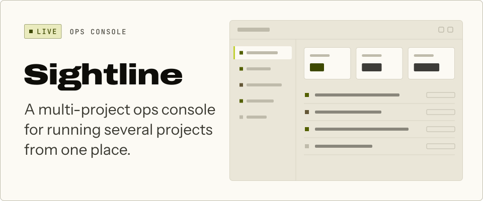

<picture>
  <source media="(prefers-color-scheme: dark)" srcset="./assets/banner-dark.svg">
  <source media="(prefers-color-scheme: light)" srcset="./assets/banner-light.svg">
  
</picture>

  Developers Army builds and runs its own AI products. Agents do the building; a human approves what ships.

  <a href="https://developersarmy.vercel.app"><picture>
    <source media="(prefers-color-scheme: dark)" srcset="./assets/button-website-dark.svg">
    <source media="(prefers-color-scheme: light)" srcset="./assets/button-website-light.svg">
    
  </picture></a>
  &nbsp;
  <a href="mailto:info@developersarmy.com"><picture>
    <source media="(prefers-color-scheme: dark)" srcset="./assets/button-email-dark.svg">
    <source media="(prefers-color-scheme: light)" srcset="./assets/button-email-light.svg">
    
  </picture></a>

 

### What we build

Products we build and run ourselves, from first idea to live.

  <a href="https://sightline.dataage.co.zw"><picture>
    <source media="(prefers-color-scheme: dark)" srcset="./assets/sightline-dark.svg">
    <source media="(prefers-color-scheme: light)" srcset="./assets/sightline-light.svg">
    
  </picture></a>

**[Visit Sightline →](https://sightline.dataage.co.zw)**

<picture>
  <source media="(prefers-color-scheme: dark)" srcset="./assets/in-the-works-dark.svg">
  <source media="(prefers-color-scheme: light)" srcset="./assets/in-the-works-light.svg">
  
</picture>

 

### How we build

**Agents build. A human signs off.** AI agents do the building. We write the brief and approve the result.

<picture>
  <source media="(prefers-color-scheme: dark)" srcset="./assets/agent-loop-dark.svg">
  <source media="(prefers-color-scheme: light)" srcset="./assets/agent-loop-light.svg">
  
</picture>

The five steps

1. **Brief.** We write up what needs building.
2. **Agent.** An AI agent picks it up and writes the code.
3. **Pull request.** The agent puts its change up for review.
4. **Review.** A person reviews it; changes go back to the agent.
5. **Ship.** Approved work goes live.

 

### Principles

A product company, not a services shop.

<table>
  <tr>
    <td width="50%" valign="top"><b>Our own products</b> Every product here is one we build and run ourselves.</td>
    <td width="50%" valign="top"><b>Small bets, shipped often</b> We place small bets and ship them. Finding customers gets the same weight as building.</td>
  </tr>
  <tr>
    <td width="50%" valign="top"><b>Stay flexible</b> We build on a platform flexible enough to move with each new tech trend.</td>
    <td width="50%" valign="top"><b>A human approves what ships</b> Agents do the building. A person reviews every release before it goes out.</td>
  </tr>
</table>

 

### AI Hub

**Coming soon.** A home for the AI tools and know-how we build and use.

 

<picture>
  <source media="(prefers-color-scheme: dark)" srcset="./assets/rule-dark.svg">
  <source media="(prefers-color-scheme: light)" srcset="./assets/rule-light.svg">
  
</picture>

  <a href="https://developersarmy.vercel.app">developersarmy.vercel.app</a>
  &nbsp;·&nbsp;
  <a href="mailto:info@developersarmy.com">info@developersarmy.com</a>

